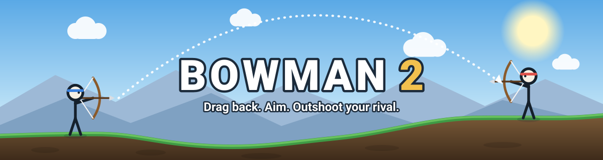
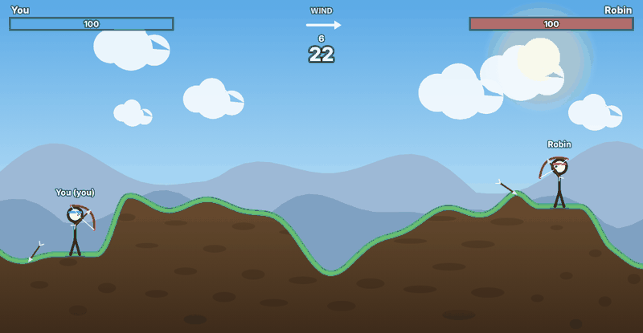
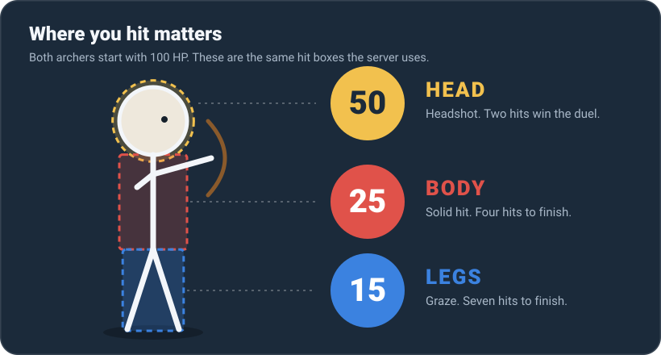
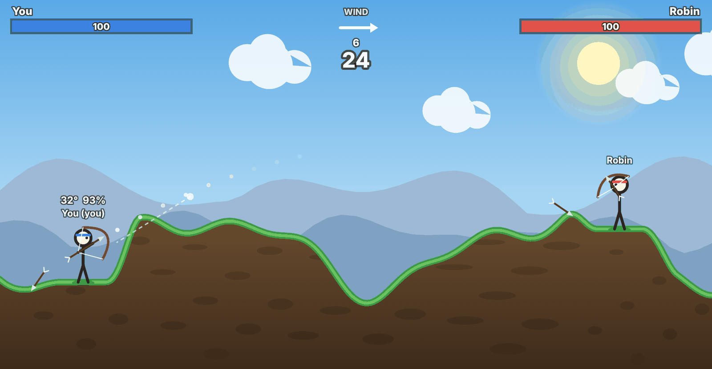
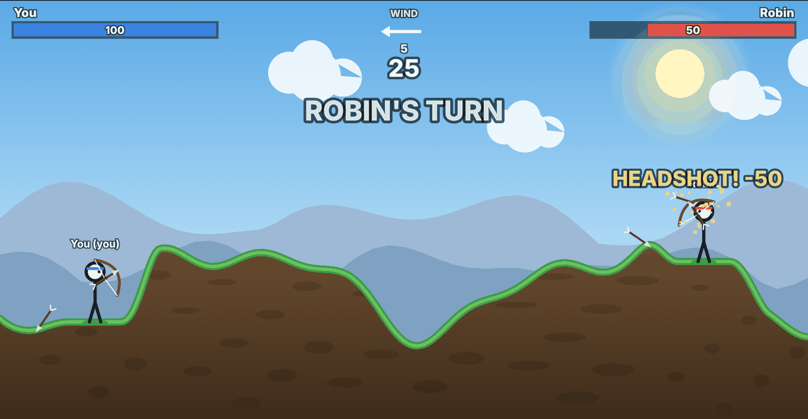
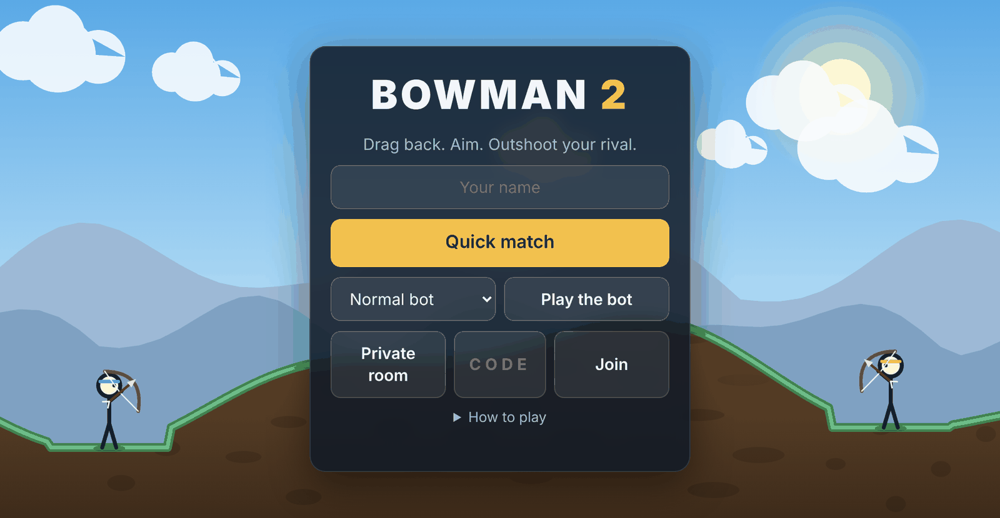
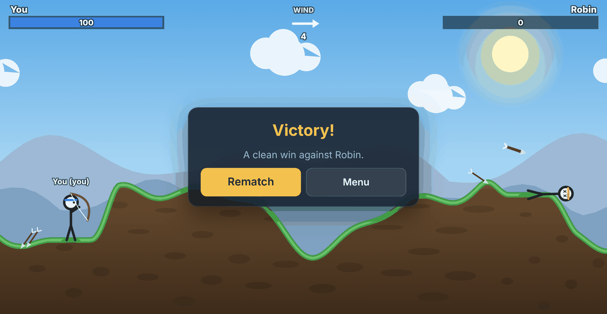
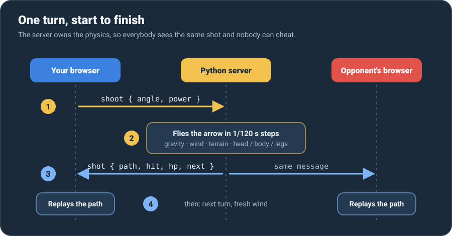

<p align="center">
  <a href="https://anantojha.github.io/bowman-2-clone/"></a>
</p>

# 🏹 Bowman 2

**A real-time two-player archery duel that runs in your browser.**
Drag back like a slingshot, let go, and put an arrow in your rival's head. Play a friend, a random opponent, or a bot.

[**▶️ Play it now**](https://anantojha.github.io/bowman-2-clone/) &nbsp;·&nbsp; [How to play](#-how-to-play) &nbsp;·&nbsp; [Run it yourself](#-run-it-yourself) &nbsp;·&nbsp; [How it's built](#-how-its-built)

[](https://github.com/anantojha/bowman-2-clone/actions/workflows/test.yml)


> 🤖 **100% of this code was created by free AI coding tools (Claude).** The game, the server, the tests and the deployment setup all came out of AI-assisted coding sessions.

<p align="center">
  
  <br><sub>A real shot, recorded from the game: drag back, release, headshot.</sub>
</p>

---

## 🎮 How to play

Open the game, pick a mode, and wait for your turn.

| Do this | To do that |
| --- | --- |
| 🖱️ **Drag back anywhere, then release** | Shoot. Direction and strength come from the drag, like a slingshot. The further you pull, the harder the shot. |
| 💨 **Watch the wind** (top centre) | Aim into it. It changes every turn. |

**The rules of the duel**

- ❤️ Both archers start with **100 HP**.
- 🎯 **Head 50 · body 25 · legs 15.** Two headshots win the match.
- 🔁 Turns alternate, and **the wind changes every turn.**
- ⏱️ You get **25 seconds** a turn. Miss **3 turns in a row** and you forfeit.
- 🤖 **Play the bot** on Easy, Normal or Hard.
- 🔑 **Private room:** share a 4-letter code with a friend and play each other.
- ⚡ **Quick match** drops you into a duel with a random opponent.

<p align="center">
  
</p>

<table>
  <tr>
    <td width="50%"><br><sub><b>Aim.</b> A short dotted guide shows your angle and power, but not the wind. Reading the wind is the skill.</sub></td>
    <td width="50%"><br><sub><b>Land it.</b> A headshot takes half your rival's health in one go.</sub></td>
  </tr>
  <tr>
    <td width="50%"><br><sub><b>Pick a mode.</b> Quick match, a bot, or a private room with a friend.</sub></td>
    <td width="50%"><br><sub><b>Win.</b> Then ask for a rematch.</sub></td>
  </tr>
</table>

> ⏳ **Heads up:** the demo runs on a free server that naps when nobody's around. The first visit can show **"Waking the server…"** for up to about a minute. After that it's quick.

---

## 🧰 How it's built

No game engine, no frameworks, no build step. A small Python server and a plain JavaScript canvas client.

```
   ┌────────────────────┐        WebSocket         ┌────────────────────────────┐
   │  Browser (canvas)  │ ◄──────────────────────► │  Python server (Starlette) │
   │  client/           │  JSON: shoot, shot, ...  │  server/  +  game/         │
   │  plain JS, no build│                          │  owns all the physics      │
   └────────────────────┘                          └────────────────────────────┘
        GitHub Pages                                          Render (Docker)
```

- **Authoritative server.** All the rules and physics live in `game/` (pure Python, no networking). Clients only send an angle and a power, so nobody can cheat their way to a headshot.
- **Replayed shots.** The server flies each arrow in 1/120 s steps (gravity, wind, terrain, head/body/legs hit boxes), then sends the whole path at 30 points per second. Both browsers replay it, so everyone sees the same shot.
- **Seeded maps.** Every match starts from a random seed. The server builds the terrain and sends the height map.
- **A bot with human-sized error.** It searches for the shot that passes closest to you, then adds some wobble. Harder levels read the wind better and shake less.
- **Built for a tiny free host.** One worker, all rooms in memory, and every connection has rate, per-IP and idle limits.

<p align="center">
  
</p>

| Bot level | Aim wobble | Reads the wind | Aims for |
| --- | --- | --- | --- |
| Easy | ±5° | poorly | the body |
| Normal | ±2.2° | decently | the upper body |
| Hard | ±0.7° | almost perfectly | the head |

<details>
<summary><b>The WebSocket messages</b></summary>

&nbsp;

JSON in both directions.

| Direction | Messages |
| --- | --- |
| Client to server | `quick`, `bot`, `create`, `join`, `cancel` / `leave`, `shoot`, `rematch`, `ping` |
| Server to client | `queued`, `room`, `start`, `shot`, `timeout`, `over`, `left`, `rematch_offer`, `error`, `full`, `pong` |

On your turn the client sends `{"t":"shoot","angle":32,"power":0.93}`. The server answers every player in the room with a `shot` message carrying the path, the hit, both HP values and the next turn's wind.

</details>

### 🗂️ Project layout

```
client/        the browser game: index.html, style.css, game.js, config.js
game/          the rules: terrain, arrow physics, hit zones, the match (no networking)
server/        WebSocket server, matchmaking and rooms, the bot, abuse limits
tests/         pytest suite for the physics, rules, bot and server
docs/          the banner, diagrams and screenshots used in this README
.github/       workflows: run the tests, publish the client to GitHub Pages
Dockerfile     one image runs the whole thing
render.yaml    Render blueprint for the game server
```

| File | What it does |
| --- | --- |
| `game/physics.py` | Terrain generator, arrow simulation, hit zones |
| `game/match.py` | One duel: turns, wind, damage, winner |
| `game/config.py` | Every tuning number (gravity, damage, turn time) |
| `server/game_server.py` | Matchmaking, private rooms, the per-room turn loop |
| `server/bot.py` | The bot |
| `server/app.py`, `server/limits.py` | HTTP and WebSocket endpoints, origin check, rate limits |
| `client/game.js` | Rendering, input, sound, message handling |

---

## 🚀 Run it yourself

### The quick way (Python 3.12)

```bash
git clone https://github.com/anantojha/bowman-2-clone.git
cd bowman-2-clone
python3 -m venv .venv
.venv/bin/pip install -r requirements-dev.txt
.venv/bin/python -m uvicorn server.app:app --port 8000
```

Then open <http://localhost:8000>. The server also serves `client/`, so there is nothing else to run. To try two players, open the page in two tabs and press **Quick match** in both.

> **Playing locally?** Leave `server` empty in `client/config.js`. An empty value means "the same host that served this page".

### With Docker

```bash
docker build -t bowman .
docker run --rm -p 8000:8000 bowman
```

Open <http://localhost:8000>. The container listens on `$PORT` (default `8000`), runs as a non-root user, and answers `/health` for health checks.

### Run the tests

```bash
.venv/bin/python -m pytest -q
```

---

## ⚙️ Settings

The server is configured with environment variables. All of them are optional.

| Variable | Default | What it does |
| --- | --- | --- |
| `BOWMAN_ALLOWED_ORIGINS` | *(any)* | Comma-separated sites allowed to open a WebSocket, for example `https://you.github.io`. Origin only: no path, no trailing slash. |
| `BOWMAN_TRUST_PROXY` | off | Set to `1` behind a proxy (Render) so the real client IP is used |
| `BOWMAN_MAX_CONNECTIONS` | `200` | Most open sockets at once |
| `BOWMAN_MAX_PER_IP` | `8` | Most sockets from a single address |
| `BOWMAN_MAX_ROOMS` | `100` | Most duels at the same time |

`GET /health` reports `status`, open `connections`, `rooms` and whether someone is `queued`.

The server keeps all rooms in memory, so **run one worker** and expect a restart to end live matches.

---

## ☁️ Deploying your own copy

The server and the client deploy separately, both on free plans.

**1. The game server on Render**

1. Push this repo to GitHub (public).
2. In Render, choose **New > Blueprint** and pick the repo. It reads [`render.yaml`](render.yaml) and builds the `Dockerfile`.
3. In `render.yaml` (or the Render dashboard), set `BOWMAN_ALLOWED_ORIGINS` to your Pages origin, for example `https://YOUR-USER.github.io`.
4. Open `https://<your-service>.onrender.com/health`. You should see `{"status":"ok", ...}`.

**2. The client on GitHub Pages**

1. **Settings > Pages > Source: GitHub Actions.**
2. **Settings > Secrets and variables > Actions > Variables:** add `BOWMAN_SERVER_URL` = `wss://<your-service>.onrender.com/ws`.
3. Push to `main`, or run the **pages** workflow by hand. It writes that address into `client/config.js` and publishes `client/`.

**If it won't connect**

- ❌ **Stuck on "Waking the server…":** the origin probably doesn't match. `BOWMAN_ALLOWED_ORIGINS` must equal the page's origin exactly, with no repo path (`https://you.github.io`, not `https://you.github.io/bowman-2-clone`).
- ❌ **"No game server configured":** the `BOWMAN_SERVER_URL` variable is missing. Set it, then re-run the **pages** workflow.
- ❌ **Pages workflow fails with "Not Found":** Pages isn't set to **GitHub Actions** yet (or the repo is private).
- 😴 **Slow first load:** free Render services sleep after about 15 minutes idle. The page pokes the server awake while you type your name.

---

## 🛠️ Hack on it

Some fun places to start:

- 🎛️ **Tune the feel** in [`game/config.py`](game/config.py): gravity, arrow speed, wind strength, damage, turn time. The stickman sizes are also drawn in `client/game.js`, so change both sides together.
- 🧠 **Make the bot smarter** in [`server/bot.py`](server/bot.py).
- 🎨 **Change how it looks** in [`client/game.js`](client/game.js) and [`client/style.css`](client/style.css).
- 🏆 **Add a rule** in [`game/match.py`](game/match.py), then write a test for it in `tests/`.

| Setting | Value |
| --- | --- |
| World | 1000 × 520 |
| Gravity | 700 px/s² |
| Full-power arrow speed | 900 px/s |
| Wind push | 70 px/s² per wind unit (−1 to 1) |
| Aim range | −20° to 85° |
| Turn time | 25 s (plus 3 s for lag) |
| Forfeit after | 3 missed turns in a row |

**Ideas to add:** shop and bow upgrades, special arrows (fire, triple shot), a ranked ladder, spectators, more maps.

---

## 🤖 About the AI

This project was created **100% by free AI coding tools (Claude)**: the game rules, the server, the client, the tests, the Docker image, the CI, and this README. AI-written code can have bugs and rough edges like any code, so issues and pull requests are very welcome.

## 📜 License

[MIT](LICENSE). Play with it, learn from it, break it, remix it.

Inspired by the stickman game *Bowman 2*. Not affiliated with it.

